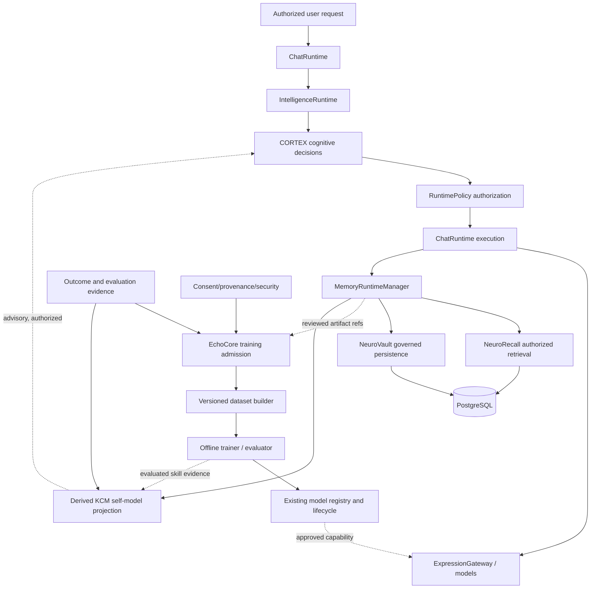

# 03 | Architecture, ownership and trust boundaries

[← Index](README.md) · [Previous](02-repository-audit.md) · [Next →](04-admission-policy.md)

## 1. Canonical architecture

**Boundaries:** No arrow means a new authority. All writes flow through existing governed persistence. Trainer/validator cannot grant new execution permissions. KCM evidence is read as an advisory projection, not command text.

## 2. Accountability matrix

| Owner | Does | Explicitly must not |
|---|---|---|
| API ingress | Identity, tenant/session context, validation, correlation ID | Model selection, datasets, training heuristics |
| IntelligenceRuntime + CORTEX | Intent/cognitive requirements and strategy eligibility | Authorize tools, execute actions, persist models |
| RuntimePolicy | RBAC, policy, resource/tenant authorization | Generate arbitrary assistant content |
| ChatRuntime | Execution, persistence, telemetry, model/tool dispatch | Maintain a new independent memory store |
| MemoryRuntimeManager | Govern memory acquisition/recall/writeback | Select neural training candidates |
| NeuroRecall | Scoped retrieval/rank/explanation | Train, persist directly, broaden scope |
| NeuroVault | Durable writes, consent, retention, revoke, lineage link | Evaluate model utility |
| EchoCore | Training admission, candidate evidence, dataset quality/curation | Reinvent LTM or grant runtime policy |
| Learning/dataset owner | Dataset versions, immutable manifests, audit | Silently ingest cross-tenant rows |
| Existing trainer/model lifecycle | SFT/LoRA jobs, evaluation, signatures and promotion receipts | Mock successful model training |
| Derived KCM projection | Display knowledge/skills/limitations as substantiated | Assert subjective consciousness or claim verified abilities without tests |

## 3. Core read flow (does not require training)

1. User request enters ChatRuntime with authenticated tenant and session scope.
2. MemoryRuntimeManager obtains allowed context through NeuroRecall.
3. Existing cognitive, outcome and personalization services provide evidence-backed KCM snapshot with time and source references.
4. CORTEX may consider a capability assessment as an **advisory** input.
5. RuntimePolicy independently authorizes; ChatRuntime executes; ExpressionGateway calls the selected actual provider/model.
6. On completion, validated task outcomes enter governed audit/learning records and may alter the derived projection.

A KCM cache is permitted only as a rebuildable projection with tenant-scoped version and invalidation. Do not introduce an authoritative KCM database of user facts.

## 4. Offline learning flow

1. A purpose-specific training objective and governed dataset policy are defined and versioned.
2. A worker enumerates only memory/event evidence refs in the authorized tenant/project scope, plus approved outcomes and correction artifacts.
3. Hard gates validate consent, rights, trust, retention, user/tenant, source license and deletion status.
4. EchoCore scores validity, learning utility and information coverage for that *objective*.
5. Approved cases become immutable typed examples with source refs and review receipts.
6. Dataset builder deduplicates and splits by leakage groups, timestamps and objective; it produces a frozen manifest and hashes.
7. Training worker runs genuine SFT/LoRA (or no training if not warranted) and validates output checkpoints.
8. Independent evaluation compares baseline and candidate; existing model registry handles approved publication/rollback.
9. Learning outcomes update KCM capability evidence, not policy permissions.

## 5. Trust boundaries

- **TB1 client->backend:** no user-supplied `tenant_id` overrides auth; no unauthenticated dataset endpoints.
- **TB2 memory->training:** retained data not implicitly trainable; `NO_TRAINING` and revoked consent override every score.
- **TB3 outside content->ground truth:** web, imported docs and tool strings are untrusted content, not instructions; validators must check independent evidence.
- **TB4 dataset->trainer:** sanitized immutable snapshot; checksum, source lineage, license and secrets scan before training.
- **TB5 trained artifact->runtime:** model license, signature, checksum, provenance, readiness and policy required; no unsafe deserialization or `trust_remote_code` by default.
- **TB6 KCM self-assessment->CORTEX:** advisory, never an authorization grant or automated capability promotion.
- **TB7 deletion->all descendants:** revoke sources and affected datasets/adapters; old checkpoints cannot silently be reused.

## 6. Operational boundaries

No new synchronous learning work in the critical chat latency path. All dataset building, scoring, sample review, training and promotion are background **worker jobs through existing durable job infrastructure**, not HTTP request work. Runtime only reads signed/certified KCM snapshots and published model artifacts.

## 7. Availability contract

If EchoCore is unavailable, ordinary memory recall, Persona prompts, provider routing and user chat remain usable. Show `training_unavailable` with a reason, not a fabricated assistant response. If a KCM projection cannot be verified, return `unknown` or `stale` capability status; never invent certainty.
