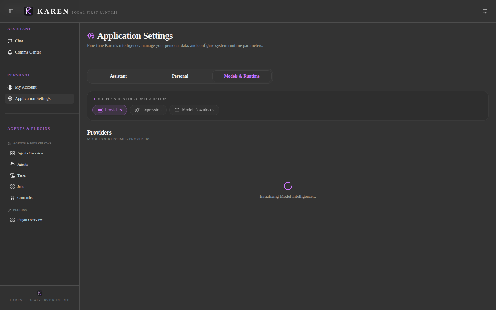

# 06. Admin settings, tenant persistence and Identity Vault

[Wiki index](README.md) · [Execution](05-execution-and-apis.md)

**Status: Implemented administrative contracts. Credential enrollment does
not imply permission to pass plaintext to a plugin.**

## Three independent scopes

| Kind of data | Owner | Who can change it |
| --- | --- | --- |
| Installation, version and enabled state | PluginKernel / host policy | Authorized plugin administrator |
| Tenant plugin configuration (nonsecret) | PluginService + PluginSettingsRepository | ADMIN_PLUGINS_MANAGE |
| Tenant plugin credentials | CredentialVaultService + plugin credential slots | ADMIN_PLUGINS_MANAGE |
| Individual user preferences (voice, display, etc.) | Authenticated user preference subsystem | That authorized user |
| One action's inputs | ExtensionExecutionService / input schema | Authorized invoker |

Do not treat an admin's plugin settings as a global user preference. Do not
store tenant settings in browser localStorage, an extension-local SQLite
database or environment-variable shadow state.

## Manifest configuration schema

The host reads "config_schema.properties". As implemented, writable
nonsecret types are **string, integer, number and boolean**. Enumerations
become select controls. Supported validation keywords include type, enum,
minimum, maximum, minLength, maxLength, pattern and multipleOf. Nested
objects, arrays, unknown/secret/read-only fields are not writable through
the ordinary settings form.

Example tenant admin settings, for a text-only plugin:

~~~json
{
  "config_schema": {
    "type": "object",
    "properties": {
      "enabled_mode": {
        "type": "string",
        "title": "Processing mode",
        "enum": ["strict", "balanced"],
        "default": "strict"
      },
      "max_characters": {
        "type": "integer",
        "title": "Maximum characters",
        "minimum": 1,
        "maximum": 2000,
        "default": 1000
      },
      "allow_preview": {
        "type": "boolean",
        "title": "Allow previews",
        "default": false
      }
    },
    "required": ["enabled_mode", "max_characters"],
    "additional_properties": false
  }
}
~~~

This is a **manifest field fragment**, not a complete plugin manifest.
For a full system manifest see [Quickstart](02-quickstart.md).

## Implemented API contracts

| Operation | Endpoint | Concurrency rule |
| --- | --- | --- |
| List configurable plugins | GET /api/extensions/settings | Admin and tenant scoped |
| Read one plugin | GET /api/extensions/{plugin_id}/settings | Returns fields, values, revision |
| Save settings | POST /api/extensions/{plugin_id}/settings | Entire nonsecret object + observed revision |
| Reset | DELETE /api/extensions/{plugin_id}/settings?revision=N | Increments revision |
| Credential field status | GET /api/extensions/{plugin_id}/credentials | No secret bytes |
| Enroll / rotate credential | POST /api/extensions/{plugin_id}/credentials/{field_key} | Write-only value + revision |
| Revoke credential | DELETE /api/extensions/{plugin_id}/credentials/{field_key}?revision=N | Version-fenced removal |

Settings changes require an authenticated tenant UUID, actor identity,
request/correlation IDs, the expected revision, and an atomic value-free
audit record in the PostgreSQL transaction. Conflicting writes receive
HTTP 409; invalid values 422; unavailable storage/migration 503. The
response is authoritative only when it returns success and a **new persisted
database revision**. A reset stores an empty override and advances the
revision instead of deleting the row.

The backing migration is
"20261114030000_51_tenant_plugin_settings.sql".
This subsystem requires deployed PostgreSQL RLS, not local memory fallback
or runtime DDL.

## Secret detection and storage

Manifest fields are treated as secrets based on keys such as password,
secret, token or credential and markers including "writeOnly",
"x-secret" and secret/password formats. Only an exact manifest-declared
string secret field can be enrolled. It is excluded from generic settings
read/write paths and stored via Identity Vault, with a tenant/plugin field
binding maintained separately.

The credential binding migration is
"20261114050000_53_plugin_vault_binding.sql". Vault state includes
enrollment, rotation, revocation, tombstones and audit without revealing
secret values in catalog responses, logs, or the UI. Revoke requires explicit
confirmation. Persistent deployments need a durable "KARI_JOB_ENC_KEY" and
verified Vault/database migrations.

**Critical limitation:** At this architecture snapshot, durable credential
enrollment is implemented, but an arbitrary extension does not receive
plaintext credentials as execution inputs. A separately governed host-only
resolver must authorize runtime secret use, including provenance, tenant,
RBAC, execution plan, revocation state and audit. Never build a plugin-owned
vault-reader endpoint or copy secrets into action JSON.

## Execution readiness

The canonical PluginService readiness gate checks installation provenance,
validated/compatible enabled manifest, dependency state, tenant settings
revision and required fields, and required Vault credential **status**.
It does not convert a readiness claim into secret injection.

Configuration-free built-ins avoid an unnecessary settings DB dependency.
Plugins with required configuration fail closed when values, revisions,
migrations or Vault evidence are unavailable.

## Race and security tests

- Missing migration, DB outage and RLS tenant mismatch.
- Forged tenant ID and unauthorized role.
- Stale expected revision / ABA conflict after reset.
- Undeclared field, nested object, overlong JSON and NaN/Infinity.
- Secret value passed in ordinary settings; returned or logged secrets.
- Rotate then revoke; revoked credential status cannot pass readiness.
- Quarantined upload cannot enroll its way into execution.
- UI cannot display a success toast after a rejected persistence operation.

Sources:
[Plugin settings repository](../../src/ai_karen_engine/services/plugin_settings_repository.py),
[PluginService](../../src/ai_karen_engine/services/plugin_service.py),
[Extension settings routes](../../src/ai_karen_engine/api_routes/extensions/extensions.py),
[Persistence tests](../../tests/integration/test_plugin_settings_postgres.py).
