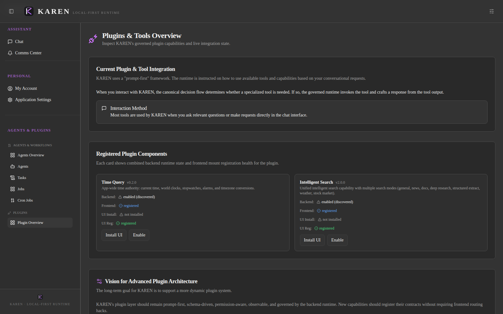

# AI KAREN Plugin Developer Wiki

> **Canonical developer documentation | audited against live main on 2026-11-15**
>
> Scope: built-in extensions, governed third-party installation, prompt contracts,
> runtime execution, tenant settings, credentials, frontend integration, and
> modality plugins. This wiki documents **current behavior** and calls out future
> proposals explicitly. It does not imply a feature is production-ready.

## Start here

KAREN is a **prompt-first, local-first** assistant. Extensions contribute
capabilities to the existing platform. They do **not** own chat orchestration,
authentication, arbitrary tenant data, model routing, or system-wide policy.

| Audience | Start with |
| --- | --- |
| First-time plugin developer | [Quickstart and complete example](02-quickstart.md) |
| Architecture reviewer | [Ownership and authority](01-architecture.md) |
| Manifest author | [Manifest and prompt reference](03-manifests-and-prompts.md) |
| Operator installing a package | [Installation, lifecycle and trust](04-lifecycle-and-trust.md) |
| Developer invoking a tool | [Execution and API contracts](05-execution-and-apis.md) |
| Admin configuring a plugin | [Settings, credentials and persistence](06-settings-and-credentials.md) |
| UI developer | [Frontend extension guide](07-frontend-integration.md) |
| Generative UI and capability developer | [Canonical generative experience contracts and migration](13-generative-experiences.md) |
| Voice/audio plugin author | [Voice and modality integration](08-voice-and-modalities.md) |
| Operator accepting Pocket TTS on actual hardware | [Pocket native speech acceptance ledger](12-pocket-tts-native-acceptance.md) |
| Test engineer | [Security, testing and telemetry](09-testing-and-observability.md) |
| Release engineer | [Packaging, upgrades and operations](10-release-and-operations.md) |
| Debugging a failure | [Troubleshooting and source map](11-troubleshooting-and-source-map.md) |

## Contract status legend

- **Implemented**: supported by current source code, subject to deployment prerequisites.
- **Partial**: an API or data model exists, but one or more production gates remain.
- **Proposed**: design direction; no shipping API or guaranteed UI.
- **Historical**: obsolete guidance retained for context only.
- **Forbidden**: security or architecture pattern deliberately excluded.

Do not treat proposed JSON examples as implemented API schemas. Capability
advertisements must agree with **actual installed, authorized, healthy runtime
behavior**.

## Five rules that outrank every tutorial

1. **One owner for each responsibility.** CORTEX decides; ChatRuntime executes;
   PluginKernel registers; ExtensionExecutionService gates invocation; plugin
   adapters implement the capability.
2. **A manifest is a request, not a grant.** RuntimePolicy, RBAC, tenant scope,
   trust provenance, consent, budgets and audit remain host-owned.
3. **Uploaded code stays quarantined.** ZIP upload does not confer in-process
   execution permission. An isolation worker is not yet verified.
4. **Keep data classes separate.** Nonsecret tenant settings go to the canonical
   PluginSettingsRepository; secrets go to Identity Vault; ordinary user
   preferences are not admin settings.
5. **Prove the entire path.** A valid manifest, green unit test or rendered
   control cannot by itself prove a live engine, permission, persisted save,
   browser integration or successful production deployment.

## Authoritative code links

- [Canonical platform manifest](../../src/ai_karen_engine/extensions/platform/core/manifest.py)
- [PluginKernel](../../src/ai_karen_engine/extensions/plugin_kernel.py)
- [ExtensionExecutionService](../../src/ai_karen_engine/extensions/executor.py)
- [PluginService](../../src/ai_karen_engine/services/plugin_service.py)
- [Tenant plugin settings](../../src/ai_karen_engine/services/plugin_settings_repository.py)
- [Extension API](../../src/ai_karen_engine/api_routes/extensions/extensions.py)
- [VoiceRuntime](../../src/ai_karen_engine/services/voice_runtime.py)
- [Runtime voice contracts](../../src/ai_karen_engine/core/voice/contracts.py)

## Other documentation

The [project development manifest](../development/PROJECT_DEV_MANIFEST.md) and
[architecture authority](../development/ARCHITECTURE_AUTHORITY.md) govern
cross-project decisions. [Extensions and Tools](../development/EXTENSIONS_TOOLS.md)
covers policy-level extension requirements. The older
[Plugin Development Guide](../DEVELOPER_PLUGINS.md) now directs readers here.
The source-adjacent [historical platform guide](../../src/ai_karen_engine/extensions/platform/docs/PLUGIN_DEV.md)
includes pre-consolidation conventions; do not copy its paths or automatic
prompt-injection assumptions into new plugins.

## Updating this wiki

Any PR changing manifests, engine readiness, permissions, plugin settings, UI
materialization, installation, or credential execution must update the
corresponding chapter and accompanying tests. Include exact file paths,
supported versions, release evidence and known gaps. If implementation differs
from a page, **source plus executable tests take precedence** and the page
must be corrected in that same PR.
