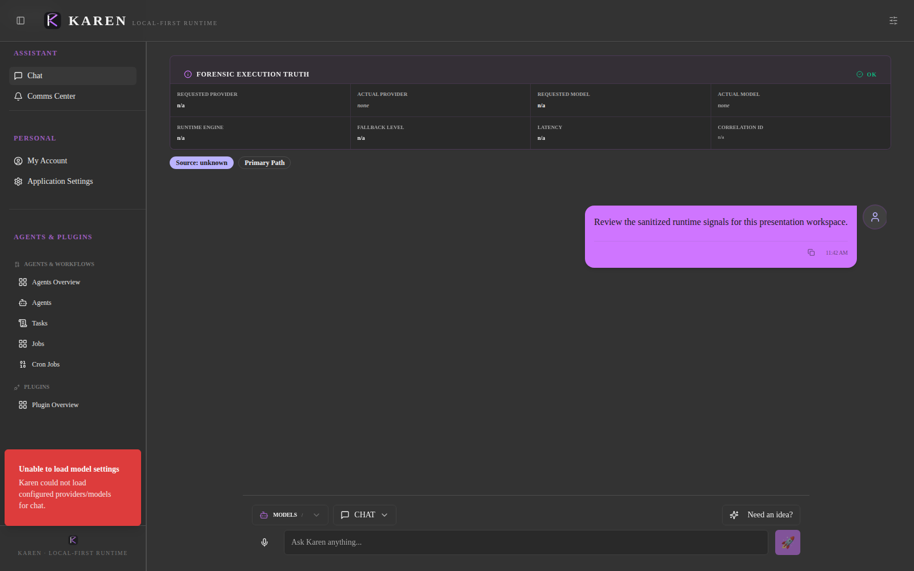

# KAREN Chat: interaction and screenshot evidence

> **Evidence classification:** The screenshot shown below is an archived, real authenticated browser capture from October 2, 2026. It is **not** a fresh test of the current interface, successful streaming, cancellation, or durable persistence. A release signoff requires a new sanitized authenticated capture and executed journey tests.

## Historical chat visual baseline

*Historical capture only. Manifest: [capture-manifest.json](../assets/screenshots/capture-manifest.json). Target application revision: `9980fb0bbcf52d162c53278d759c6632dc416a24`, operator-attested. Capture harness revision: `87213d021e4f30987c222fa716ddce3edce8c9fc`. Chromium 147, viewport 1600 × 1000, dark scheme, sanitized-demo account. A current screenshot must replace the baseline for current-feature claims.*

Do **not** copy this historical capture to a new filename or imply it depicts the changes merged via [#475](https://github.com/agustealo/AI-Karen/pull/475), [#476](https://github.com/agustealo/AI-Karen/pull/476), or [#477](https://github.com/agustealo/AI-Karen/pull/477).

The repository [README](../../README.md) already reuses the reviewed historical [plugin ecosystem](../assets/screenshots/03-plugin-ecosystem.png) and [communications center](../assets/screenshots/04-comms-center.png) captures. Maintain their existing historical-provenance caveat.

## Verified source changes and pending browser proof

| Change | Code owner | Browser acceptance |
|---|---|---|
| Multiline input, Enter/Shift+Enter, IME handling | `src/ui_launchers/Karen-AI-Theme/src/components/chat/interface/ChatInput.tsx` | Enter submits once; Shift+Enter preserves newline; IME does not submit |
| Streaming status outside the draft | `src/ui_launchers/Karen-AI-Theme/src/components/chat/ChatInterface.tsx` | Typed next-message draft stays intact while status changes |
| Abort ownership and recovered orphan lock | `src/ui_launchers/Karen-AI-Theme/src/components/chat/const/requestHandlers.tsx` | Stop releases the UI after stream unwinds; no false terminal completion; restored orphan can stop |
| Server/local transcript reconciliation | `src/ui_launchers/Karen-AI-Theme/src/components/chat/ChatInterface.tsx` | Reload confirms durable message identity, ordering, status, and response provenance |

## Executable acceptance journeys

Use the already-owned Playwright browser config at `src/ui_launchers/Karen-AI-Theme/e2e/playwright.config.ts`. The generic E2E rail stores **engineering evidence**, not marketing screenshots. The canonical five-screen showcase authority is `src/ui_launchers/Karen-AI-Theme/e2e/showcase/`, governed by `.github/workflows/presentation-capture.yml`.

| Journey | User action | Expected observable result | Required evidence |
|---|---|---|---|
| Compose | Enter several lines with Shift+Enter, send | One request; newlines retained | Screenshot before/after, browser trace, actual payload |
| Stream and draft | Start stream and type a second message | Draft never becomes status text and remains editable | Mid-stream screenshot, event trace |
| Stop and resend | Stop during content delivery, immediately send new message | No late-completed old answer, duplicate, spliced fallback, or cleanup race | Before/after screenshots, request IDs and terminal events |
| Interrupted retry | Cancel during a retry delay | No new retry after cancellation | Trace, request/event correlation |
| Restore orphan | Refresh while request was in-flight, then Stop | Orphan lock released; draft remains accessible | Screenshot, restoration and Stop actions, observed state |
| Durable reopen | Send a completed response, refresh and reopen | Backend-confirmed transcript retains message identity, ordering and content | Before/after screenshots, conversation API evidence |
| Failed persistence | Simulate a server persistence error in approved test environment | UI does not claim saved; local recovery is visibly provisional | Screenshot, error and server receipt |
| Responsive | Repeat relevant journeys at 390×844, 768×1024, and 1440×900 | No clipping, blocked composer, hidden Stop, or inaccessible focus | Screenshots at each viewport |

### Defect evidence contract

For every defect, record: tested user action, expected outcome, observed result, current app revision, environment, screenshot path, trace path, correlation/request ID (redacted), responsible source file, severity, and retest outcome. A screenshot on its own is not evidence that streaming or persistence succeeded.

### Screenshot reuse policy

1. Prefer linking existing governed screenshots instead of duplicating binary files.
2. Historical captures are suitable for dated design comparison or feature-location context with an explicit age/revision disclaimer.
3. Promote only currently valid, manually inspected, manifest-backed captures to the product README.
4. Never publish captures containing personal/production data, secrets, unresolved failures, or misleading mock UI.
5. Do not regenerate historical assets by editing them; use the trusted showcase workflow on a sanitized current deployment.
6. Before release, run `python scripts/ci/verify_presentation_assets.py --require-assets` and review all five new images at native size.

### Verification status (October 18, 2026)

- PRs #475, #476 and #477 merged after internal checks.
- Current-version authenticated browser journeys: **not executed in this audit**.
- Current-version streaming/cancellation/persistence screenshots: **not captured**.
- The October 2 historical gallery remains an **archived visual baseline**, not release acceptance.

Keep runtime execution authority in the backend; this document does not change the runtime or its security boundaries.
